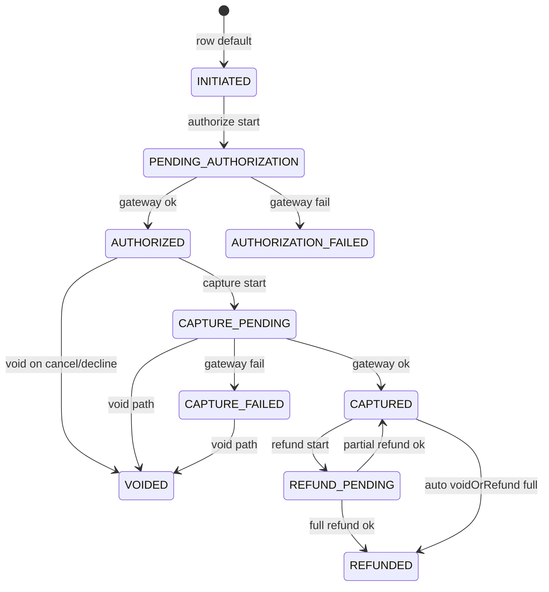

# 38 — Phase 6A Payments Architecture Audit

| Field | Value |
| --- | --- |
| Document | Phase 6A Payments Architecture Audit |
| Product | Clinexa |
| Version | 1.0 |
| Status | Audit complete — Phase 6B–6D on `feature/payments-architecture-audit` (6D thin checkout implemented) |
| Primary market | International (merchant registration country undecided) |
| Audience | Payments Architecture, Backend Engineering, Product, Security, Compliance, QA |
| Source of truth | Repository inspection on `feature/payments-architecture-audit` @ `37008f9` |
| Related docs | [15 — Payment Flow](15-payment-flow.md), [10 — Database design](10-database-design.md), [11 — API design](11-api-design.md), [25 — Guardian](25-guardian.md), [35 — Orders](35-orders-module.md), [36 — Subscriptions](36-subscriptions-module.md), [26 — Implementation tracker](26-implementation-tracker.md) |
| Stripe policy verification date | 2026-11-22 |

This document is the **Phase 6A audit and implementation plan** for evolving Clinexa Payments into a production-ready, provider-independent payment domain with Stripe as the proposed initial PSP. It records **verified repository facts**, **assumptions**, and **recommendations**. It does not implement Stripe, change schemas, or alter runtime behavior.

> **Legend:** **Fact** = verified in repository or official Stripe docs. **Assumption** = not proven in code. **Recommendation** = proposed for later phases.

---

## Table of contents

1. [Executive summary](#1-executive-summary)
2. [Existing Payments architecture](#2-existing-payments-architecture)
3. [Existing database models and relationships](#3-existing-database-models-and-relationships)
4. [Payments API inventory](#4-payments-api-inventory)
5. [Orders integration audit](#5-orders-integration-audit)
6. [Subscriptions integration audit](#6-subscriptions-integration-audit)
7. [Simulated provider assessment](#7-simulated-provider-assessment)
8. [Stripe feasibility and eligibility assessment](#8-stripe-feasibility-and-eligibility-assessment)
9. [Security and reliability assessment](#9-security-and-reliability-assessment)
10. [International currency assessment](#10-international-currency-assessment)
11. [Guardian Payments UI assessment](#11-guardian-payments-ui-assessment)
12. [Identified architectural gaps](#12-identified-architectural-gaps)
13. [Recommended target architecture](#13-recommended-target-architecture)
14. [Proposed database changes](#14-proposed-database-changes)
15. [Proposed API changes](#15-proposed-api-changes)
16. [Proposed implementation phases](#16-proposed-implementation-phases)
17. [Testing strategy](#17-testing-strategy)
18. [Migration and backward-compatibility considerations](#18-migration-and-backward-compatibility-considerations)
19. [Risks, blockers and unresolved business decisions](#19-risks-blockers-and-unresolved-business-decisions)
20. [Payment financial state machine (deep dive)](#20-payment-financial-state-machine-deep-dive)
21. [Idempotency and duplicate-charge analysis (deep dive)](#21-idempotency-and-duplicate-charge-analysis-deep-dive)
22. [Webhook reliability (deep dive)](#22-webhook-reliability-deep-dive)
23. [Financial auditability assessment (deep dive)](#23-financial-auditability-assessment-deep-dive)
24. [Authorization expiry vs clinical review (deep dive)](#24-authorization-expiry-vs-clinical-review-deep-dive)
25. [Revision history](#25-revision-history)

---

## 1. Executive summary

**Fact:** Clinexa already has a working **simulated** Payments domain: a provider-agnostic `PaymentGateway`, `SimulatedPaymentAdapter`, `PaymentsService`, Prisma models (`Payment`, `Refund`, `SavedPaymentMethod`, `PaymentWebhookEvent`), staff Admin/CRM APIs, and Order/Subscription hooks that implement Authorize → Clinical Review → Capture → Fulfillment for Rx orders.

**Fact:** There is **no** real PSP integration. `PAYMENTS_PROVIDER` is constrained to `simulated`. Patient/store checkout payment HTTP routes documented in [11](11-api-design.md) remain unmounted.

**Critical business verdict (Stripe):** Prescription-medicine, online pharmacy, prescription delivery, and telemedicine are listed as **Restricted** (not automatically allowed) on Stripe’s [Prohibited and Restricted Businesses](https://stripe.com/legal/restricted-businesses) page (verified 2026-11-22). Approval is not guaranteed. If Stripe does not approve Clinexa’s Rx model for the chosen merchant country, a **Stripe-only production strategy is infeasible for prescription payments**. Stripe **test-mode** technical success does **not** establish merchant eligibility or production readiness.

**Critical engineering gaps:** duplicate-charge risk on `retry-payment`; renewal failed-auth retry may not re-call the gateway; webhook apply failures can be permanently skipped; no auth-expiry tracking; USD-default money model; incomplete financial audit trail (initiator source, captured vs authorized amounts as separate facts, settlement currency).

**Recommendation:** Keep one `PaymentsModule`, extend `PaymentGateway`, add `StripeAdapter` for test-mode engineering, keep simulated for local/CI. Preserve Orders and Subscriptions as source of truth. Prefer minimal field/process changes to existing `Payment`/`Refund` before any ledger or PaymentAttempt table. Gate live Rx processing on merchant entity, licenses, and Stripe restricted-business decision.

---

## 2. Existing Payments architecture

### 2.1 Module layout (Fact)

| Path | Role |
| --- | --- |
| `apps/api/src/modules/payments/payments.module.ts` | Nest module; binds `PAYMENT_GATEWAY` → `SimulatedPaymentAdapter` |
| `payment.gateway.ts` | Provider-agnostic interface |
| `payment.types.ts` | Gateway I/O types, tokens |
| `simulated-payment.adapter.ts` | Deterministic simulated PSP |
| `payment-provider.registry.ts` | Read-model metadata only (no multi-adapter resolve) |
| `payments.service.ts` | Domain orchestration |
| `payments-webhook.controller.ts` | `POST /v1/webhooks/payments` |
| `admin-payments.controller.ts` / `crm-payments.controller.ts` | Staff payment list/detail/refund |
| `payment-methods.controller.ts` | Alternate saved-method routes |
| `admin-payment-providers.controller.ts` | Provider config read |
| `worker-secret.guard.ts` | Internal job auth (shared with renewals) |
| `dto/*.ts` | Refund and saved-method DTOs |

Registered from `apps/api/src/app.module.ts`. Wired to Orders/Subscriptions via `commerce-integration.module.ts`.

### 2.2 Gateway contract (Fact)

```18:25:apps/api/src/modules/payments/payment.gateway.ts
export interface PaymentGateway {
  authorize(input: GatewayAuthorizeInput): Promise<GatewayAuthorizeResult>;
  capture(input: GatewayCaptureInput): Promise<GatewayCaptureResult>;
  void(input: GatewayVoidInput): Promise<GatewayVoidResult>;
  refund(input: GatewayRefundInput): Promise<GatewayRefundResult>;
  cancelRecurring(input: GatewayCancelRecurringInput): Promise<void>;
  verifyWebhook(input: GatewayWebhookVerifyInput): boolean;
}
```

**Missing from interface (Fact):** customer create, SetupIntent/tokenize, PaymentIntent create/retrieve, `requires_action` / 3DS, signed webhook verification using raw body, auth-expiry return values.

### 2.3 Capability classification

| Capability | Classification | Notes |
| --- | --- | --- |
| Module structure, service, DTOs, unit/int tests | Implemented | Strong simulated coverage |
| `Payment` / `Refund` / `SavedPaymentMethod` / webhook event models | Implemented | DB-028–031 |
| Provider abstraction | Partially implemented | Interface exists; registry cannot select adapters |
| Simulated provider | Simulated only | Hard-wired |
| Authorization / capture / void / refund | Partially implemented | Works for renewals + staff retry; no checkout |
| Saved payment methods | Simulated only | Staff-fabricated refs; no patient tokenize API |
| Webhooks | Partially implemented | Shared-secret; insert-before-apply; fragile on apply failure |
| Idempotency | Partially implemented | Unique keys; refund Idempotency-Key; retry uses random keys |
| Patient/store payment APIs | Missing | Documented unmounted |
| Real PSP (Stripe) | Missing | Explicitly deferred in docs/15 |
| Reconciliation job | Missing | Documented intent only |
| Auth expiry handling | Missing | — |
| PaymentAttempt / ledger tables | Missing | Not present; evaluate need before adding |
| Audit logging / metrics | Missing / minimal | Refund actor + OrderActivity only |

### 2.4 Environment (Fact)

From `env.validation.ts` / `.env.example` / `payments.config.ts`:

- `PAYMENTS_PROVIDER` = `simulated` only
- `PAYMENTS_WEBHOOK_SECRET`, `PAYMENTS_SIMULATED_FORCE`, `WORKER_SHARED_SECRET`
- Renewal cron flags under payments config
- `PAYMENTS_MODE` / `PAYMENTS_WEBHOOK_PUBLIC_BASE` used in config but not fully zod-validated
- No Stripe API keys

### 2.5 Authoritative product docs (Fact)

- [docs/15-payment-flow.md](15-payment-flow.md) — payment architecture SoT (`PAY-*`)
- [docs/10-database-design.md](10-database-design.md) — `DB-028`–`031`
- [docs/11-api-design.md](11-api-design.md) — `API-060`–`068`

---

## 3. Existing database models and relationships

### 3.1 Enums (Fact)

**PaymentStatus:** `PENDING`, `AUTHORIZED_OR_CAPTURED`, `FAILED`, `REFUNDED`

**PaymentLifecycleState:** `INITIATED`, `PENDING_AUTHORIZATION`, `AUTHORIZED`, `AUTHORIZATION_FAILED`, `CAPTURE_PENDING`, `CAPTURED`, `CAPTURE_FAILED`, `VOIDED`, `REFUND_PENDING`, `REFUNDED`, `CANCELLED`

**PaymentPurpose:** `RENEWAL`, `CHECKOUT`

**RefundStatus:** `PENDING`, `SUCCEEDED`, `FAILED`

**OrderStatus:** `DRAFT`, `PAYMENT_PENDING`, `AWAITING_CLINICAL_REVIEW`, `CLINICAL_APPROVED`, `CLINICAL_DECLINED`, `AWAITING_FULFILLMENT`, `FULFILLED`, `CANCELLED`, `REFUNDED`

**SubscriptionStatus:** `PENDING_SETUP`, `ACTIVE`, `PAUSED`, `PAST_DUE`, `CANCELLED`, `EXPIRED`, `COMPLETED`, `MIGRATED`

### 3.2 Models (Fact)

| Model | Key fields | Relations |
| --- | --- | --- |
| `Payment` | `amountCents`, `currency` default `"USD"`, status, lifecycleState, purpose, provider refs, `idempotencyKey` unique | Order?, Subscription?, SavedPaymentMethod?, Refund[], WebhookEvent[] |
| `Refund` | `amountCents`, status, `providerRefundRef`, reason, `actorUserId`, `idempotencyKey` unique | Payment, Order? |
| `SavedPaymentMethod` | `providerMethodRef`, brand/last4/exp, soft-delete | User, Payment[] |
| `PaymentWebhookEvent` | `provider`+`providerEventId` unique, `payloadHash`, `appliedAt` | Payment? |

**Order payment fields:** `paymentIntentId?`, `latestPaymentId?`, `paymentStatusSummary?`, `refundedTotalCents`, `idempotencyKey?`

**Subscription payment fields:** `paymentMethodId?`, `providerCustomerRef?`, `providerSubscriptionRef?`, `latestPaymentId?`, `paymentStatusSummary?`

**Not present:** PaymentAttempt, Transaction ledger, Dispute, ProviderCustomer, auth-expiry column, initiator/source column, settlement currency.

Migrations of note: `20260824180000_payments_domain_and_order_idempotency`, `20260826100000_payments_admin_indexes`.

---

## 4. Payments API inventory

All under `/v1` unless noted. (Fact)

| Route | Auth / permission | Behavior |
| --- | --- | --- |
| `POST /webhooks/payments` | Public + `x-payments-webhook-secret` | `ingestWebhook` |
| `GET /admin/payments` | `ORD_VIEW` | List |
| `GET /admin/payments/:id` | `ORD_VIEW` | Detail |
| `POST /admin/payments/:id/refunds` | `PAY_INITIATE_REFUND` + Idempotency-Key | Staff refund |
| `GET/POST …/admin/payments/users/:userId/payment-methods` | `PAY_MANAGE_METHODS` | Saved methods |
| `PATCH/DELETE …/make-default` | `PAY_MANAGE_METHODS` | Update/delete/default |
| `GET /admin/payment-providers` | `SET_OVERSELL_POLICIES` | Provider read-model |
| `…/admin/users/:userId/payment-methods…` | `ORD_VIEW` / `ORD_EDIT` | Duplicate method routes |
| CRM mirrors for refunds + methods | `PAY_*` / `CRM_PATIENT_RECORDS` | Same service methods |
| `POST /admin|crm/orders/:id/retry-payment` | `ORD_EDIT` | `retryOrderAuthorization` |
| `POST /internal/jobs/subscription-renewals` | Worker secret | Renewal batch |

**Missing (Fact):** Store/Portal checkout initiate, patient saved-method self-service (`API-062`–`066`, `API-082` per docs), SetupIntent client-secret endpoints, provider retrieve/reconcile admin tools.

---

## 5. Orders integration audit

### 5.1 Lifecycle (Fact)

Allowed transitions live in `order-lifecycle.service.ts`. Clinical approve/decline require `source === 'clinical'`. Terminal: `FULFILLED`, `CANCELLED`, `REFUNDED`.

### 5.2 Payment timing (Fact)

Policy Authorize → Clinical → Capture → Fulfill is implemented:

| Order type | Authorize | Capture |
| --- | --- | --- |
| Rx (`isRxOrder`) | Before `AWAITING_CLINICAL_REVIEW` | On transition into `AWAITING_FULFILLMENT` (`capture_required` hook) |
| Non-Rx | Before fulfillment | Immediate after authorize (retry path / renewal) |
| Zero total | Synthetic noop payment id | Capture hook short-circuits |

Hooks: `paymentHookForTransition` → `authorization_recorded` | `capture_required` | `void_or_refund_required` → `PaymentsService.handleOrderPaymentHook`.

### 5.3 Cancellation / clinical decline (Fact)

- `void_or_refund_required` when moving to `REFUNDED`, `CLINICAL_DECLINED`, or `CANCELLED` (except from `DRAFT`)
- `voidOrRefundForOrder`: CAPTURED → full refund; AUTHORIZED / CAPTURE_PENDING / CAPTURE_FAILED → void
- Clinical decline stops at `CLINICAL_DECLINED`; does **not** auto-transition to `REFUNDED`/`CANCELLED`
- Staff `initiateRefund` updates `Order.refundedTotalCents` but does **not** change order status
- Cancel/decline refund path does **not** call `onRefundSucceeded` → `refundedTotalCents` may be stale

### 5.4 Gaps affecting Orders (Fact / Recommendation)

| Issue | Classification |
| --- | --- |
| No Store checkout payment entry — only `retry-payment` + renewals | Missing |
| `retry:{orderId}:{random}` can authorize multiple payments for one order | Needs architectural changes |
| Manual staff transitions from `PAYMENT_PENDING` skip real auth (`authorization_recorded` is no-op) | Partially implemented / risk |
| Capture uses stored `payment.amountCents`, not post-auth adjusted `Order.totalCents` | Gap |
| Auth hold may expire during clinical review | Missing handling (see §24) |

**Recommendation:** Do not introduce new Order statuses. Fix financial hooks and idempotency within existing statuses.

---

## 6. Subscriptions integration audit

### 6.1 Statuses and rules (Fact)

Statuses match product rules. Terminal: `CANCELLED`, `EXPIRED`, `COMPLETED`, `MIGRATED`. `CANCELLED` cannot reactivate. `PAUSED` is “On Hold” in UI. `MIGRATED` is terminal. Renewal orchestration is inside Subscriptions (`subscriptions-renewal.processor.ts`), not a Renewals domain.

### 6.2 Billing flow (Fact)

1. Internal job / optional cron → `processDueBatch`
2. Lock due `ACTIVE` / retryable `PAST_DUE` rows
3. Create/reuse `SubscriptionRenewalAttempt` + renewal `Order` (`PAYMENT_PENDING`) from snapshots
4. Authorize with key `renewal:{subId}:{period}:authorize`
5. Rx → clinical; non-Rx → capture → `AWAITING_FULFILLMENT`
6. Period advance only after capture + eligible order status

Payment method: opaque `Subscription.paymentMethodId` → `SavedPaymentMethod.id`; ownership checked at charge time.

### 6.3 Gaps (Fact)

| Issue | Impact |
| --- | --- |
| Failed authorize creates FAILED payment; retry reuses same idempotency key → may return FAILED without gateway re-call | Stuck PAST_DUE / no re-attempt |
| Retry throttle is grace-period window only; no max retries / backoff schedule | Weak recovery |
| Zero-total renewal may write synthetic `zero-total-noop` into UUID `latestPaymentId` | Data integrity risk |
| Inventory failure after capture holds money without auto-refund | Ops risk |
| `COMPLETED` has no automatic setter in production code | Status unused |

**Recommendation:** Keep renewal orchestration in Subscriptions. Fix authorize retry semantics and payment-method SetupIntent association in Phase 6E. Do not adopt Stripe Billing as source of truth for subscription lifecycle.

---

## 7. Simulated provider assessment

**Fact:** `SimulatedPaymentAdapter` generates stable refs from hashes; supports force `decline` / `timeout`; void/refund always succeed; webhook verify is string equality on shared secret.

**Classification:** Simulated only — appropriate for local development and automated tests.

**Recommendation:** Retain forever for CI. Expand simulated outcomes later for `requires_action`, auth expiry, and unknown/timeout reconciliation scenarios. Never remove it when adding Stripe.

---

## 8. Stripe feasibility and eligibility assessment

**Verification date:** 2026-11-22  
**Primary official source:** [https://stripe.com/legal/restricted-businesses](https://stripe.com/legal/restricted-businesses)

### 8.1 Prohibited vs Restricted (Fact — Stripe legal)

| Classification | Meaning (Stripe) |
| --- | --- |
| **Prohibited** | Must not use Stripe for that activity |
| **Restricted** | Additional due diligence; Stripe “might not be able to grant approval”; approval service-specific and revocable |

### 8.2 Clinexa category mapping (Fact — Stripe list wording)

| Clinexa business element | Stripe list | Classification |
| --- | --- | --- |
| Online pharmacies, including SaaS platforms | Pharmaceuticals, medical devices, and telemedicine | **Restricted** |
| Card-not-present prescription-only products and pharmaceuticals | Same | **Restricted** |
| Prescription delivery services | Same | **Restricted** |
| Telemedicine and telehealth services | Same | **Restricted** |
| Prescription-only and regulated medical devices | Same | **Restricted** |
| Pseudo-pharmaceuticals / nutraceuticals that are not safe or make harmful claims | Nutraceuticals and pseudo-pharmaceuticals | **Prohibited** |
| Legitimate non-prescription medical / wellness (safe, lawful claims) | Not listed in that restricted Rx set | May be supportable subject to Stripe review, local law, and product claims — **not** an automatic green light |

### 8.3 Technical feasibility (Fact — Stripe docs)

| Capability | Support | Source |
| --- | --- | --- |
| Cards, international presentment currencies | Supported (merchant-country dependent) | [Currencies](https://docs.stripe.com/currencies), [Global](https://stripe.com/global) |
| Manual authorize then capture | Supported (`capture_method=manual`) | [Place a hold](https://docs.stripe.com/payments/place-a-hold-on-a-payment-method) |
| Saved methods / off-session / mandates | Supported (SetupIntents, SCA) | [Setup Intents](https://docs.stripe.com/payments/setup-intents), [SCA](https://docs.stripe.com/strong-customer-authentication) |
| Refunds | Supported | Stripe Refunds API |
| Webhooks with signature verification | Supported | Stripe Webhooks docs |

### 8.4 Complete business-model verdict

**Fact:** Prescription-medicine payments are essential to Clinexa’s intended model.

**Recommendation / verdict:**

1. Technical Stripe PaymentIntents/SetupIntents integration is feasible for engineering.
2. Merchant eligibility for Rx / pharmacy / telemedicine is **Restricted** — **do not assume approval**.
3. If Stripe denies or cannot support the Rx/pharmacy/telemedicine category for the chosen merchant country, a **Stripe-only production strategy is infeasible for that transaction category**.
4. Non-Rx wellness alone does **not** satisfy the intended business model.
5. **Forbidden:** disguising prescription transactions, splitting payments, or misclassifying MCC/categories to bypass restrictions.
6. Merchant registration must reflect a legitimate business structure in a supported Stripe country; do not assume an overseas shell entity is appropriate.

### 8.5 Test mode vs production eligibility (Clarification — mandatory)

| Statement | Requirement |
| --- | --- |
| Test-mode integration | Does **not** establish merchant eligibility |
| Successful test transactions | Do **not** constitute business-model approval |
| Restricted-business + legal/regulatory eligibility | Assessed **independently** of engineering |
| Test-mode work | Must **not** be represented as production readiness |
| Live credentials / production processing | Remain **disabled** until merchant onboarding and relevant approvals are confirmed |
| Test mode | Must **not** imply prohibited/restricted categories are approved |

Phase **6C** is an **engineering milestone only**, not a go-live or eligibility gate.

### 8.6 Unofficial secondary notes (Assumption — not Stripe legal page)

Third-party articles claim pharmaceutical waiver support is limited to certain countries and that cross-border Rx sales may be disallowed. Treat as **unofficial** until confirmed with Stripe Sales/Support and counsel for the chosen entity.

---

## 9. Security and reliability assessment

| Control | Status | Notes |
| --- | --- | --- |
| No raw PAN/CVV in DB | Implemented | Only token refs + last4 metadata |
| PCI scope reduction via PSP tokenization | Missing for real PSP | Needed for Stripe Elements/SetupIntent |
| Secret management | Partially | Dev secrets as defaults; no prod refuse-on-default |
| Webhook signature (HMAC + raw body) | Missing | Shared-secret header only |
| Webhook idempotency | Partially | Unique event id; apply-failure hole |
| Duplicate payment prevention | Partially | Broken for random retry keys |
| Concurrent refund locking | Partially | Staff refund uses `FOR UPDATE`; void/auto path weaker |
| Auth expiry | Missing | — |
| Refund integrity | Partially | Cumulative staff refunds OK; cancel path ignores prior partials |
| Audit logging | Minimal | See §23 |
| Provider timeouts / unknown outcomes | Partially | Simulated timeout; no reconcile |
| Reconciliation Clinexa ↔ Stripe | Missing | — |
| Retry policies | Partially | Subscription grace only |

**Recommendation:** Never store card numbers/CVVs. Use Stripe-hosted collection. Enforce production secret validation before live mode.

---

## 10. International currency assessment

**Fact:** Docs state USD V1; Prisma defaults `currency = "USD"` on Payment and related commerce models; admin formatters assume 2-decimal `$` display.

**Fact (business input for this phase):** Initial production market is **international**; merchant registration country is **undecided**.

| Concern | Assessment |
| --- | --- |
| ISO currency codes | String field exists; not validated as ISO 4217 |
| Minor-unit amounts | Integer `*Cents` — good pattern; name is USD-centric |
| Zero-decimal currencies (e.g. JPY) | Not handled in formatters or validation |
| Presentment vs settlement | Not modeled separately |
| FX / provider rate | Not stored |
| Refund currency | Assumed same as payment currency |
| Merchant-country restrictions | Cannot finalize until entity country known |

**Sources:** [Stripe currencies](https://docs.stripe.com/currencies), [Stripe global](https://stripe.com/global) (verified 2026-11-22).

**Recommendation:** Represent money as integer minor units + ISO code; never floats. Keep **transaction (presentment) currency** and **settlement currency** conceptually separate. Do not hardcode USD as universal default in new APIs. Finalize supported presentment set after merchant country decision.

**Decisions blocked until merchant country known:** payout/settlement currency, which presentment currencies Stripe enables for that account, local payment methods, tax/reporting, Rx restricted-business approval path.

---

## 11. Guardian Payments UI assessment

**Fact — routes / features:**

| Screen | Path / component | Capabilities |
| --- | --- | --- |
| Payments list | `guardian/payments` | Search, table, links to order |
| Payment detail | `guardian/payments/[id]` | Identity, linked records, refunds, webhooks; refund form |
| Providers | `guardian/settings/payment-providers` | Read-only provider/mode/capabilities/webhook URL |
| User methods | CRM/user panels | Add/list/default/delete simulated methods |
| Order retry | Orders feature panel | Retry payment |

**Missing UI:** webhook ops/replay, reconciliation, cross-user method admin, provider refs display completeness, timeline rendering (data fetched but unused on detail), status filters despite API support.

**Design system:** Shared patterns in `apps/admin/src/components/patterns/`; tokens in `globals.css`; payment statuses largely registered in `status-semantics.ts`. Detail/providers pages are partially hand-rolled vs `ClinexaPage`/`PageHeader`.

**Recommendation:** Phase 7 modernizes UI against canonical Guardian patterns. Phase 6A does not redesign UI.

---

## 12. Identified architectural gaps

1. **Eligibility blocker** for live Rx via Stripe (Restricted; approval unknown).
2. **No checkout money path** for patient Store/Portal.
3. **Duplicate authorize risk** on staff `retry-payment`.
4. **Renewal auth failure** may not re-hit provider.
5. **Webhook apply failure** permanently skipped on redelivery.
6. **Void vs refund** semantics incomplete on decline/cancel + `refundedTotalCents` drift.
7. **No auth expiry** tracking vs clinical SLA.
8. **Financial auditability** incomplete (initiator source, authorized vs captured as distinct reconstructable facts, settlement currency) — see §23.
9. **Currency** USD-centric defaults vs international market.
10. **Gateway** lacks intent/tokenize/`requires_action`/retrieve.
11. **Registry** cannot select Stripe vs simulated by config.
12. **Unknown outcome** / timeout reconciliation missing.

---

## 13. Recommended target architecture

**Recommendation — smallest clean fit:**

```text
Store / Patient Portal / Guardian
        ↓
Clinexa PaymentsModule (single module)
  ├── Eligibility / policy checks (app-level)
  ├── PaymentsService (intents, auth, capture, void, refund, methods)
  ├── Webhook processing + reconcile retrieve
  └── Subscription billing integration hooks (called by Subscriptions)
        ↓
PaymentGateway (interface)
        ↓
   ┌────┴────┐
Simulated   StripeAdapter (test-mode first; live gated)
Adapter
```

**Principles:**

- One `PaymentsModule`; no microservices; no Renewals domain; no duplicate transaction registries.
- Clinexa remains SoT for Orders and Subscriptions.
- Stripe-specific SDK/API details stay inside `StripeAdapter` (+ thin webhook verify helpers).
- Prefer extending existing models over new ledger/attempt tables unless §23 proves insufficient.
- Use Stripe PaymentIntents + SetupIntents; **do not** make Stripe Billing the subscription lifecycle SoT.
- Keep simulated provider for local/CI.

---

## 14. Proposed database changes

**Recommendation — Phase 6B evaluate first; migrate only what audit requires.** Prefer additive nullable columns on `Payment` / `Refund` / `PaymentWebhookEvent` before new tables.

| Candidate change | Why | Affects |
| --- | --- | --- |
| `authorizedAmountCents`, `capturedAmountCents` (or derive rules) | Reconstruct auth vs capture | Payment |
| `authorizationExpiresAt` / `captureBefore` | Clinical vs hold window | Payment |
| `initiator` / `source` enum (USER, RENEWAL_JOB, WEBHOOK, STAFF, SYSTEM) | Auditability | Payment, Refund |
| `settlementCurrency` optional | International settlement | Payment |
| Persist void provider ref + void timestamp | Auth cancel audit | Payment |
| Webhook `processingStatus`, `lastError`, `attemptCount`, raw payload retention policy | Reliable apply/retry | PaymentWebhookEvent |
| Provider idempotency key stored explicitly | Duplicate prevention | Payment |
| Currency validation (ISO) | International | Payment, Order, etc. |

**Do not** add PaymentAttempt/ledger in 6B unless reconstruction still fails after minimal columns. If multiple Payment rows per order remain the attempt history, document that convention and harden uniqueness (e.g. at most one non-terminal payment per order).

**Do not** change OrderStatus or SubscriptionStatus enums without a documented business requirement.

---

## 15. Proposed API changes

| Change | Phase | Notes |
| --- | --- | --- |
| Config-selectable `PAYMENTS_PROVIDER=simulated\|stripe` | 6B/6C | Live mode gated |
| Stripe webhook HMAC endpoint (raw body) | 6C | Separate from shared-secret sim webhook or dual verify |
| Store/Portal: create payment intent / confirm / SetupIntent | 6D | Mount documented APIs carefully |
| Harden `retry-payment` idempotency | 6B/6D | Stable key; refuse if AUTHORIZED/CAPTURED exists |
| Admin reconcile / retrieve payment | 6F | Sync from provider |
| Patient payment-method self-service | 6D/6E | Tokenized only |
| Env: Stripe test keys only until approvals | 6C | Live keys disabled by policy |

Preserve existing Admin/CRM refund and list contracts where possible; extend response DTOs for new audit fields.

---

## 16. Proposed implementation phases

### Phase 6B — Foundation (no live Stripe) — **implemented**

- **Scope:** Gateway contract extensions; money/currency rules; financial state invariants; idempotency hardening; auth-expiry fields; webhook reliability design; auditability columns if needed.
- **Likely files:** `payment.gateway.ts`, `payment.types.ts`, `payments.service.ts`, `payments.module.ts`, Prisma schema (additive), `env.validation.ts`, Orders retry path, renewal processor retry keys.
- **Dependencies:** None on Stripe account approval.
- **DB:** Minimal additive fields; no Order/Subscription status changes.
- **API:** Mostly internal; possibly admin field expansions.
- **Tests:** Unit + concurrency; schema specs; no Stripe SDK required.
- **Acceptance:** Simulated flows still green; duplicate retry blocked; void≠refund documented in code; audit fields reconstructible for happy path.
- **Risks:** Over-modeling; resist PaymentAttempt unless necessary.
- **Status (2026-11-22):** Delivered on `feature/payments-architecture-audit` (migration `payments_phase6b_foundation`).

### Phase 6C — Stripe test-mode integration — **implemented**

- **Scope:** `StripeAdapter`, test keys, signed webhooks, provider registry selection.
- **Dependencies:** 6B; Stripe test account (engineering).
- **DB:** Provider refs populated from Stripe ids; unique `Refund.providerRefundRef` (nullable).
- **API:** Webhook path for Stripe events (`/v1/webhooks/payments/stripe`).
- **Tests:** Adapter unit tests with Stripe test fixtures/mocks; contract tests.
- **Acceptance:** Authorize/capture/void/refund round-trip in **test mode**; simulated still default for CI.
- **Risks:** Misreading test success as eligibility — **explicitly forbidden** (§8.5). Live credentials disabled.
- **Status (2026-11-22):** Delivered on `feature/payments-architecture-audit` (`stripe@23.2.0`, API `2026-11-18.endive`).

### Phase 6D — One-time card payments + order lifecycle — **implemented**

- **Scope:** Thin patient checkout initiate + pay/reconcile; Rx auth→clinical→capture; non-Rx capture; decline void/refund; auth expiry without clinical→PAYMENT_PENDING edges; owner-only SCA `clientSecret`.
- **Dependencies:** 6C.
- **DB:** Additive `orders.idempotency_request_hash` (`payments_phase6d_checkout_idempotency_hash`) — apply only after isolated DB confirmation.
- **API:** `POST /v1/checkout`, `POST /v1/orders/:id/pay`, reconcile, patient `GET /v1/orders/:id` (no Store UI).
- **Tests:** Checkout/fingerprint/advance + Stripe SCA/Search unit coverage; simulated CI default.
- **Acceptance:** No duplicate charges; ACTION_REQUIRED does not advance; decline voids/refunds correctly; fulfill requires CAPTURED; test-mode ≠ eligibility.
- **Risks:** Clinical review longer than hold window; Elements/Store client still deferred.
- **Status (2026-11-22):** Delivered on `feature/payments-architecture-audit`.

### Phase 6E — Subscription renewal reliability

- **Scope (delivered):** Durable attempt lease; payment-idempotency-first reclaim; zero-total before PM; fixed grace + min delay + max `a{n}`; SCA hold (no new PI); grace-end cancel via Payments; wire auth-failure webhook; conditional period advance. **Deferred:** SetupIntent/mandate, method-replacement APIs, Stripe Billing cancel.
- **Dependencies:** 6D patterns; keep Subscriptions SoT.
- **DB:** Additive `claim_token` / `lease_expires_at` on `subscription_renewal_attempts` (migration on disk; apply separately).
- **API:** Renewal job entrypoint unchanged; no new PM/SetupIntent endpoints.
- **Tests:** Renewal processor 6E matrix (lease, SCA hold, grace abandon, stale webhook, zero-total).
- **Acceptance:** PAST_DUE recovery re-attempts only after terminal prior payment; CANCELLED/MIGRATED rules intact; no Stripe Billing SoT; SCA hold ≠ confirmed failure.
- **Risks:** Unconfirmed PI cancel may leave actionable Stripe intent (staff/runbook); product-tunable retry knobs.
- **Status (2026-11-22):** Delivered on `feature/payments-architecture-audit`.

### Phase 6F — Refunds, webhooks, reconciliation

- **Scope:** Partial/full refund integrity; webhook retry/replay; provider retrieve when webhook lost; reconcile job.
- **Dependencies:** 6C–6E.
- **Acceptance:** Missed webhook recovered via retrieve; refundable amounts correct; Order.refundedTotalCents consistent.
- **Risks:** Out-of-order Stripe events.

### Phase 6G — Security, reliability, E2E

- **Scope:** IDOR/RBAC close (staff shell AND; remove PAY_MANAGE IDOR routes; defer patient `/me` PM); production secret fail-closed + `PAYMENTS_ALLOW_SIMULATED`; R1 confirmed-failure refund reservation; R3 canonical capture recovery; R4 order-lock authorize exclusivity; R2 requires_action retrieve; ops runbook ([39](39-phase-6g-ops-runbook.md)).
- **Acceptance:** S1–S4, R1/R3/R4 evidence for Phase 7 API readiness; R2/T/O3 for declaring 6G complete; no ledger/live Stripe/Guardian UI/SetupIntent.
- **Risks:** Shipping live mode without Rx approval; claiming multi-worker correctness without Postgres int (`RUN_POSTGRES_INTEGRATION=1`).

### Phase 7 — Guardian Payments UI

- Modernize list/detail/providers/methods/webhooks/reconcile using canonical design system.

### Phase 8 — Orders and Subscriptions UI

- Surface payment state, retry, expiry, decline financial outcomes correctly.

**Business gate (outside engineering):** Merchant legal entity/country + licenses + Stripe restricted-business decision before any **production** Stripe strategy that includes prescription payments.

---

## 17. Testing strategy

| Layer | Coverage |
| --- | --- |
| Unit | PaymentsService state machine, void vs refund, idempotency conflicts, webhook dedupe/apply failure |
| Concurrency | Existing `payments.concurrency.int.spec.ts` pattern for refunds; extend to authorize races |
| Contract | PaymentGateway fake + StripeAdapter mocked HTTP |
| Integration | Postgres; renewal processor auth-failure retry |
| E2E (later) | Stripe test-mode cards; 3DS test cards; webhook CLI fixtures |
| Negative | Timeout → unknown → reconcile; expired auth; duplicate webhook |
| Regression | Simulated provider remains CI default; boundaries tests keep Subscriptions free of Stripe imports |

Do not require live Stripe or production credentials in CI.

---

## 18. Migration and backward-compatibility considerations

- Additive schema only; backfill nullables.
- Existing simulated Payment rows remain valid.
- Staff APIs keep path compatibility; extend fields.
- `retry-payment` behavior change (idempotent) is a **bugfix** — document in changelog.
- Renewal idempotency key strategy change needs careful migration for in-flight FAILED attempts (e.g. new key suffix `:attemptN` or reset policy).
- Currency default `"USD"` retained until product sets multi-currency defaults post merchant decision.
- Do not break Order/Subscription status machines.

---

## 19. Risks, blockers and unresolved business decisions

### Production blockers

1. **Stripe Restricted-business approval** for online pharmacy / CNP prescription / prescription delivery / telemedicine — undecided; may be denied.
2. **Merchant legal registration country** — undecided; blocks settlement currency, presentment set, and eligibility path.
3. **Licenses / pharmacy / telemedicine regulatory compliance** for operating jurisdictions.
4. **Clinical review SLA vs authorization validity windows** — may force re-auth workflow.

### Unresolved product/engineering decisions

- Primary presentment currencies and pricing localization
- Whether extended authorization is available/eligible for Clinexa’s MCC
- Patient-facing checkout UX (Elements vs Checkout Session)
- Max renewal retries and dunning notifications timing
- Whether non-Rx SKUs can launch on Stripe before Rx approval (business choice; still must not misclassify Rx)

### Engineering risks already in code

- Duplicate charges via random retry keys
- Webhook poison-pill on apply failure
- Refund total drift on cancel/decline
- Renewal FAILED payment sticky idempotency

---

## 20. Payment financial state machine (deep dive)

### 20.1 Implemented transitions (Fact)



Collapsed `PaymentStatus`: AUTHORIZED and CAPTURED both map to `AUTHORIZED_OR_CAPTURED` until refunded/failed.

### 20.2 Void vs refund (Expected vs actual)

| Financial state | Expected money action | Order semantic |
| --- | --- | --- |
| Authorized, not captured | **Void/cancel** authorization | Not “refunded” financially |
| Captured | **Refund** (full/partial) | Order `REFUNDED` only after verified refund when policy requires |

**Fact:** `voidOrRefundForOrder` broadly follows this split. Clinical decline triggers the hook but order may remain `CLINICAL_DECLINED` without moving to `REFUNDED`.

**Recommendation:** Never mark payment/order `REFUNDED` without a SUCCEEDED refund row (or verified provider refund) for captured funds; never call a captured payment “voided.”

### 20.3 Saved payment method lifecycle (Fact)

Create (staff, fabricated sim ref) → optional default → soft-delete (`deletedAt`). Default cannot be deleted. No expiry check at authorize. No patient SetupIntent.

### 20.4 Dead / unused states (Fact)

`PaymentLifecycleState.CANCELLED` and default `INITIATED` are rarely/never assigned in success paths. `RefundStatus.PENDING` is default but staff path may not persist PENDING durably; FAILED refund rows can roll back with the transaction on gateway throw.

---

## 21. Idempotency and duplicate-charge analysis (deep dive)

### 21.1 Layers

| Layer | Current | Gap |
| --- | --- | --- |
| API Idempotency-Key | Required on staff refunds | Not on retry-payment / authorize |
| DB unique `Payment.idempotencyKey` | Yes | Callers choose keys |
| DB unique `Refund.idempotencyKey` | Yes + body replay check | — |
| Webhook `(provider, providerEventId)` | Yes | Apply-after-insert failure |
| Provider idempotency | N/A (simulated) | Required for Stripe |
| Concurrent authorize | P2002 re-read | Only same key |

### 21.2 Outcome distinctions (Recommendation)

| Outcome | Meaning | Safe retry |
| --- | --- | --- |
| Failed | Provider declined / hard fail recorded | New attempt with **new** key after FAILED terminal |
| Pending | Waiting on provider / 3DS | Do not create second charge; poll/retrieve |
| Unknown | Timeout / lost response | Retrieve by provider ref / idempotency key before retry |
| Provider success, Clinexa lag | Webhook delayed | Reconcile retrieve; do not re-authorize |

### 21.3 Hotspots (Fact)

1. `retryOrderAuthorization` uses `retry:{orderId}:{randomBytes}` → **new Payment every click** even if prior AUTHORIZED/CAPTURED exists.
2. Renewal uses stable key → FAILED sticky → **may never re-call gateway**.
3. Webhook: insert event then apply; on apply throw, redelivery hits unique constraint → `{duplicate:true}` → **skipped forever**.

### 21.4 Smallest reliable design (Recommendation)

Without a new PaymentAttempt table:

1. **One active money intent per order:** before authorize, refuse if latest payment is AUTHORIZED, CAPTURE_PENDING, CAPTURED, or REFUND_*; allow new authorize only if none or terminal FAILED/VOIDED/CANCELLED.
2. **Stable staff retry key:** e.g. `retry:{orderId}:{paymentMethodId}:{amountCents}` or require client Idempotency-Key.
3. **Renewal re-attempt:** on FAILED, use `…:authorize:v{retryCount}` or clear/supersede policy explicitly.
4. **Stripe Idempotency-Key** on all mutating provider calls; store provider payment id immediately when known.
5. **Unknown outcome:** mark lifecycle pending/unknown; reconcile via retrieve before second charge.
6. Multiple FAILED Payment rows can serve as attempt history if linked to the same order — document that convention.

Introduce PaymentAttempt **only if** (1)–(5) cannot express concurrent in-flight attempts cleanly.

---

## 22. Webhook reliability (deep dive)

| Concern | Current | Target |
| --- | --- | --- |
| Signature | Shared secret header | Stripe HMAC + raw body; sim may keep secret |
| Duplicates | Unique providerEventId | Keep; add processing status |
| Out-of-order | Not handled | Apply with state guards (ignore obsolete) |
| Replay | Partial | Allow replay of `appliedAt IS NULL` or failed status |
| Processing failure | Event stuck, redelivery skipped | Status=failed; retry worker |
| Atomic updates | Mixed | Prefer transactional apply + status |
| Recovery if Stripe paid but webhook lost | Missing | Periodic reconcile: list/retrieve PaymentIntents by metadata/order id |

**Recommendation:** Webhooks are an optimization; **provider retrieve + reconcile** is mandatory for correctness.

---

## 23. Financial auditability assessment (deep dive)

Question: Can existing `Payment` + `Refund` reconstruct complete financial history?

| Required fact | Reconstructable today? | Evidence / gap |
| --- | --- | --- |
| Total authorized amount | **Partial** | `amountCents` when AUTHORIZED; no separate authorized amount if capture differs |
| Total captured amount | **Partial** | Inferred when `CAPTURED` (`amountCents`); no partial capture field |
| Total refunded amount | **Mostly** | Sum `Refund` where SUCCEEDED; cancel-path full refund creates Refund; staff path yes; verify cancel always writes Refund |
| Remaining refundable | **Mostly** | `amountCents - sum(SUCCEEDED)` for CAPTURED; staff API computes `refundableCents` |
| Provider ref per action | **Partial** | Auth/capture/payment/refund refs exist; void result ignored; no per-attempt history beyond row updates |
| Transaction currency | **Yes** | `Payment.currency` (default USD) |
| Settlement currency | **No** | Not modeled |
| Operation timestamps | **Partial** | `createdAt`/`updatedAt` only — cannot distinguish authorize vs capture time precisely |
| Related Order / Subscription | **Yes** | FKs |
| Initiating source (user / renewal / webhook) | **No** | Not stored; infer weakly from `purpose` / idempotency key prefix |
| Final provider-confirmed outcome | **Partial** | Lifecycle + status; webhook lag / unknown timeout not first-class |

**Verdict (Recommendation):** Existing models are a **viable base**. They do **not** yet satisfy complete auditability without **minimal** additive fields (initiator/source, auth expiry, authorize/capture timestamps or event log-lite, settlement currency optional, void ref). A separate ledger or PaymentAttempt table is **not** automatically required; prefer columns + strict Refund rows for every captured-money return + reconcile job. Reassess after 6B design spike; only then consider a thin `PaymentEvent` append-only table if timestamped action history remains insufficient.

---

## 24. Authorization expiry vs clinical review (deep dive)

**Fact (Stripe docs, verified 2026-11-22):** Uncaptured PaymentIntents are cancelled after a network-dependent window. Card-not-present examples from [Place a hold](https://docs.stripe.com/payments/place-a-hold-on-a-payment-method):

| Brand | MIT window | CIT window |
| --- | --- | --- |
| Visa | ~5 days (4d18h clearing) | 7 days |
| Mastercard / Amex / Discover | 7 days | 7 days |

These are **estimates / network rules**, not a Clinexa guarantee. Extended authorization exists for some eligible online card payments (Stripe docs). Automatic delayed capture is a separate Stripe feature/preview.

**Fact (Clinexa):** Rx path holds authorization through clinical review with **no** expiry field or job.

**Assumption:** Clinical review may exceed 5–7 days for some orders.

**Recommendation (preserve Authorize → Clinical → Capture → Fulfill):**

1. Persist `authorizationExpiresAt` from provider when available.
2. Define clinical SLA ≤ conservative hold window; alert when approaching expiry.
3. If expired before approval: void/cancel locally; require **re-authorization** before capture/fulfillment; keep existing order statuses (e.g. remain or return to `PAYMENT_PENDING` / stay in clinical with payment flag — product choice without inventing statuses unless needed).
4. Evaluate extended authorization eligibility with Stripe for Clinexa’s MCC after merchant setup.
5. Never assume indefinite holds.

---

## 25. Revision history

| Version | Date | Notes |
| --- | --- | --- |
| 1.0 | 2026-11-22 | Phase 6A audit on branch `feature/payments-architecture-audit` from `origin/main` @ `37008f9`. Documentation only; no application code, schema, migration, or dependency changes. |
| 1.1 | 2026-11-22 | Phase 6B foundation implemented on same branch: minor-unit money allow-list, staff retry Idempotency-Key contract, renewal `authorizeAttemptNumber`, auth expiry/void-on-confirm, webhook lease claims, unknown-outcome reconcile stubs (simulated), refund authority + initiator audit fields. No Stripe SDK. |
| 1.2 | 2026-11-22 | Phase 6C Stripe test-mode: StripeAdapter, PM ownership verify, HMAC webhooks, Search best-effort recovery, `ACTION_REQUIRED`, partial refund.* accounting, cancelRecurring unsupported soft result. Live keys rejected. |
| 1.3 | 2026-11-22 | Phase 6D thin checkout: patient checkout/pay/reconcile, durable fingerprint, owner-only `clientSecret`, ACTION_REQUIRED-safe advance, ONE_TIME void-on-reserve-fail, AF capture-retry, webhook retrieve-before-capture. No Elements/live keys. |
| 1.4 | 2026-11-22 | Phase 6E renewal reliability: attempt lease + heartbeat, SCA hold, grace-end abandon via Payments cancelPendingAuthorization, fixed grace/backoff/max attempts, onRenewalAuthorizationFailed wired, conditional completeRenewalOnCapture. SetupIntent/PM APIs still deferred. |

---

## Document control

- **Change rule:** Update this document when Phase 6B+ decisions change architecture, eligibility status, or merchant country.
- **Phase 6B–6E** are implemented on `feature/payments-architecture-audit`; Phase 6F+ still require explicit approval.
- **Live Stripe / Rx processing** must not start without merchant onboarding and restricted-business outcomes recorded.
